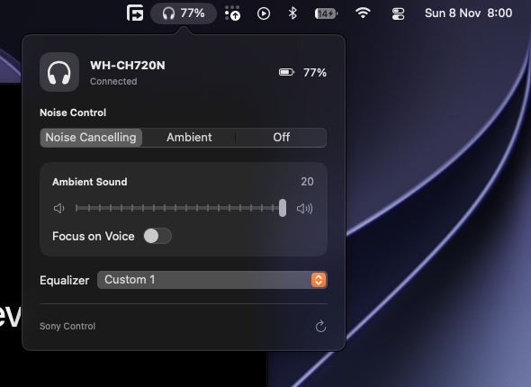
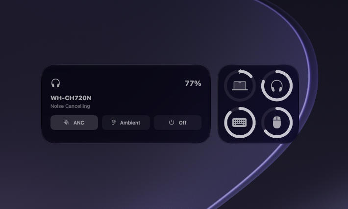

# Sony Control for WH-CH720N

Control noise cancellation, ambient sound, voice focus, saved EQ presets, and battery status directly over Bluetooth from macOS. Built from analysis of Sound Connect 13.3.0 and verified against the user's WH-CH720N, firmware 1.1.4.

## Screenshots

**Menu bar controls** — noise control, ambient sound, voice focus, EQ presets, and battery status.



**Desktop widget** — headphone battery and sound mode with ANC, Ambient, and Off shortcuts.



## Open the menu bar controls

Version 0.3 uses a native menu bar popover. The installed app is at `~/Applications/Sony Control.app`:

```sh
open "$HOME/Applications/Sony Control.app"
```

Click the headphones icon to open the controls directly below it. Click outside or press Escape to dismiss them. The popover uses system colors, typography, a segmented noise-control picker, standard sliders/switches, and an EQ menu. It adapts to light and dark appearance.

Allow Bluetooth access if macOS asks. Pair/connect WH-CH720N in macOS Bluetooth settings first. Close Sound Connect on the phone if the control connection fails, then click Refresh. The phone is not required during normal use.

The popover offers ANC, Ambient, Off, ambient level 1–20, Focus on voice, EQ presets, battery status, and Refresh. It keeps one Bluetooth connection open, receives setting notifications, and refreshes status every 45 seconds while idle. Ordinary clicks reuse the connection and cached confirmed state. Rapid changes queue up; unsent changes to the same control coalesce to the latest value. Slider changes send when you release the slider. Selecting ambient level or voice focus activates Ambient mode.

The battery icon/value stays separate from connection activity. On disconnect, the last known battery remains visible beside a disconnected label. Reconnection uses bounded backoff; a short channel-close cooldown applies only when reconnecting.

Right-click the menu bar icon for Reconnect, Disconnect controls, and Quit. **Disconnect controls before using Sound Connect or the terminal client** to avoid competing control connections. Disconnecting controls leaves Bluetooth audio connected.

## Build

Requires macOS 14+ for the Notification Center widget (the controller itself targets macOS 13+), Apple command line developer tools with Swift 5.9+, and a paired WH-CH720N. Tested on this Apple Silicon Mac with macOS 27 and Swift 6.4. Earlier macOS versions have not been verified.

```sh
tools/install-app.sh
open "$HOME/Applications/Sony Control.app"
```

The app is locally ad hoc signed. No dependencies are downloaded. ANC/EQ control uses IOBluetooth RFCOMM, not a phone relay or a web Bluetooth API.

## Add the Notification Center widget

Open Notification Center by clicking the date/time in the menu bar, choose **Edit Widgets**, search for **Sony Headphones** (or Sony Control), then add the small or medium widget. You can also place it on the desktop through macOS's widget gallery.

The small widget shows the headphone battery and sound mode; clicking it opens the controls. The medium widget adds ANC, Ambient, and Off links. These open Sony Control and apply the mode through its existing Bluetooth connection. Keep Sony Control running for current status. Widget refresh timing is managed by macOS; it may lag behind the popover. The app requests a reload when battery, mode, or connection changes.

The widget reads only battery/mode/connection status from `127.0.0.1:52721`; the listener accepts only a status GET and binds only to loopback. No Bluetooth commands are accepted on this endpoint. This avoids app-group signing requirements for local ad hoc builds. The extension is sandboxed with network-client access. Small and medium previews were successfully rendered by the macOS widget service; adding the widget and tapping its links in Notification Center still require user verification.

## Terminal controls

From this project directory:

```sh
swift run sony-control status
swift run sony-control anc
swift run sony-control ambient 10
swift run sony-control ambient 10 voice
swift run sony-control ambient 10 normal
swift run sony-control off
swift run sony-control eq custom1
swift run sony-control menu
```

EQ choices: `off`, `bright`, `excited`, `mellow`, `relaxed`, `vocal`, `treble`, `bass`, `speech`, `manual`, `custom1`, `custom2`. Selecting a preset recalls its saved values; custom band editing is not implemented. Add `--verbose` for local packet logs.

Use one controller instance at a time. The program matches the exact Bluetooth name `WH-CH720N` and requires exactly one paired match. Renamed headsets need to be renamed back or the matching code adapted. If the headset changes mode on its own, check Sound Connect's adaptive sound settings.

## Can ANC be stronger?

No supported ANC-strength or boost command was found for this WH-CH720N. Its advertised control selects ANC or Ambient mode; the 1–20 value is **ambient passthrough**, not cancellation strength. Other Sony models' NC enums do not establish extra capabilities on this headset. This client does not modify firmware or send undocumented out-of-range boost values.

## Verification and research

```sh
swift run ProtocolChecks
swift run sony-control verify
```

`ProtocolChecks` runs eight offline capture/parser and sound-state regression checks without XCTest (the installed command line toolchain lacks XCTest). `verify` briefly cycles Off, Ambient, ANC, voice focus, and EQ Off, then restores the sound and EQ snapshot. Keep the headset connected until it reports restoration. A process kill or Bluetooth loss can prevent restoration; Sound Connect can recover the settings.

The updated async controller passed live mode, voice-focus, EQ, and exact restoration checks. Warm mode changes took 629–764 ms in this session, including readback; cold connection and reconnection take longer. This is a local measurement, not a guarantee. A widget queue check exercised rapid mode/level/voice changes, battery retention, exact sound/EQ restoration, and disconnect/reconnect.

The update's hardware checks restored the user's then-current Ambient mode, level 20, voice focus off, and Custom 1 EQ. See [the menu bar and Notification Center update](docs/2026-11-01_menu-widget-update.md), [the earlier widget update notes](docs/2026-11-01_widget-update.md), [async hardware evidence](research/evidence/widget-hardware.txt), [the initial research report](docs/2026-11-01_reverse-sound-connect-report.md), and [initial verification evidence](research/evidence/hardware-verification.txt).

To repeat APK extraction with ADB, JADX, apktool, and Java installed:

```sh
tools/extract-app.sh
```

For multiple ADB devices, set `ANDROID_SERIAL` first. APKs and decompiled Sony sources remain local under ignored `research/` directories. This repository contains an independent client implementation and protocol notes.

This is an experimental, unofficial client scoped to this WH-CH720N. Firmware updates, multipoint/device management, DSEE, adaptive sound automation, and other headphone models are not implemented.
